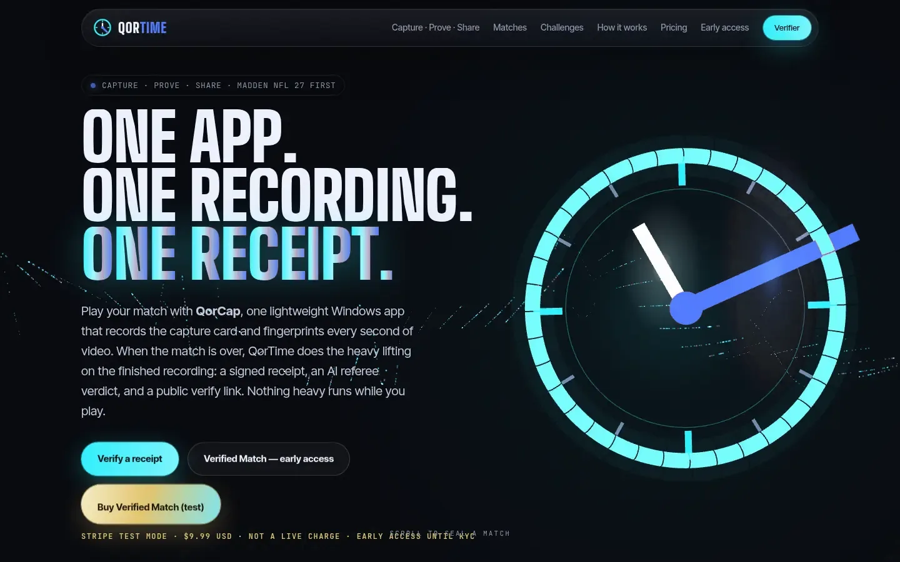
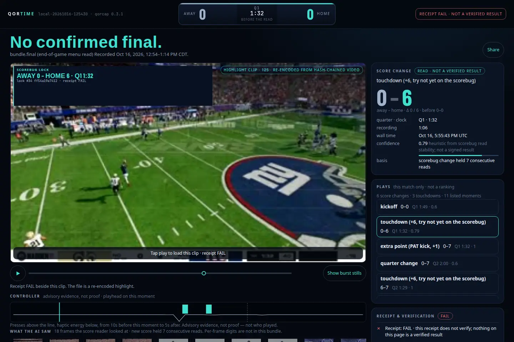
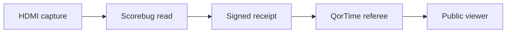

<picture>
  <source media="(prefers-color-scheme: dark)" srcset="docs/readme/hero-dark.svg">
  <source media="(prefers-color-scheme: light)" srcset="docs/readme/hero-light.svg">
  
</picture>

# QorTime

**QorTime is the open-source referee for [QorCap](https://github.com/ConWan30/qorcap):** it checks a signed capture receipt and publishes the verdict the math actually returns, including FAIL.

QorCap, on the player's Windows PC, records an HDMI capture card, reads the scorebug locally, and signs a match receipt (ed25519). QorTime verifies that receipt and serves the public match pages. The package name is still `qor_receipt`. Both `qortime` and `qor-receipt` work. MIT licensed.

[](LICENSE)
[](https://github.com/ConWan30/qorcap/releases/tag/v0.3.37)
[](https://qortime.com/)
[](https://x.com/QorTimeHQ)

One published match is referee-verified (n = 1): [match 170123](https://qortime.com/matches/170123/), away 10 – home 0, played Oct 23, 2026 (CT). On a match page, gold digits mean the receipt status is `VERIFIED`. That page uses them. The two older pages do not.

Not affiliated with EA, the NFL, or Sony. Madden NFL is a trademark of its owner. Game footage in the shots below is the capture already published on those pages.

## See it live

**[Match 170123](https://qortime.com/matches/170123/)** — the first referee-verified match on this site (n = 1). Madden, Oct 23, 2026 (CT). The verifier, with this receipt's referee key pinned, returns **VERIFIED**. Away 10 – home 0, score source `end_menu_read`. Signed by referee `qortime-online-s2` (delegation serial 2 from root `qortime-v1`). All 7 review checks in the receipt pass: `bundle_structure`, `capture_chain`, `video_bytes` (spot-check 166/525 segments), `final_reread`, `challenges` (3, rule 2), `motion` (rule 3, 521 per mille, 63 bins), `input_integrity`. The verifier's motion floor is 300. The receipt's Not proven list stays on the page. Footage is not published; the recording stays on the player's PC. The public transparency log lists this receipt at sequence 1 (submission id `64a1a54b77948a49`, the same id in `review.submission`). Open it in the [verifier](https://qortime.com/verify/?receipt=https%3A%2F%2Fqortime.com%2Fmatches%2F170123%2Freceipt.json&referee=b283cffb9279f2f90859268c64ef21861ef7e5d9fc773bdb8061af0e80624889).

**[Site](https://qortime.com/)** — the public homepage. Diagrams on that page that are not a captured match are labeled illustrative.

[](https://qortime.com/)

**[Match 125430](https://qortime.com/matches/125430/)** — clips tied to the signed receipt. The page checks the proof in the browser and shows **RECEIPT FAIL · NOT A VERIFIED RESULT**. Published verifier errors:

- `home:cp[0]:gap_too_long`
- `home:cp[591]:gap_too_long`
- `home:cp[591]:clock_skew`
- `home:cp[592]:clock_skew`

Two checkpoints are too far apart, and two show clock skew. The last scorebug read on the page is not a confirmed final. Clips stay visible and are not marked locked.

[](https://qortime.com/matches/125430/)

Browser verifier (no account, nothing uploaded): <https://qortime.com/verify/>

## Meta AI Developer Hackathon (Oct 26 – Nov 4 2026)
QorTime is in the Startup track. Pre-existing work vs hackathon work is listed in [`HACKATHON.md`](HACKATHON.md).
Hackathon code lives in new, labeled paths (for example `qor_receipt/ai_ruling/`, an advisory Muse Spark explainer
that never changes a verdict). The capture client lives in [`ConWan30/qorcap`](https://github.com/ConWan30/qorcap); see its [`HACKATHON.md`](https://github.com/ConWan30/qorcap/blob/main/HACKATHON.md).

### How Meta models are used
| Model | Role in this product / demo |
|---|---|
| **Muse Spark 1.3** | Signed plain-English receipt explanation; default second score reader (lower-only on disagreement); Show Your Hands play-start filter (remove-only) |
| **SAM 3.1** | Scorebug locator for viewers (info only; never a status signal) |
| **Muse Voice Transcribe 1.0** | Demo-video captions (keyword-fixed ASR in the submission demo pipeline) |

Full separation table, measured numbers, and in-window PR list: [`HACKATHON.md`](HACKATHON.md).

### Demo video
**(link coming)** — three-minute-class demo of the hackathon-built Meta advisory layer on a real VERIFIED match. Hosted URL will be pasted into the Cerebral Valley submission form.

## How it works



1. **HDMI capture.** QorCap records the capture card on Windows and fingerprints the video as it is written (hash chain, timestamped checkpoints). Since v0.3.0 it also logs controller button reports from that same session.
2. **Scorebug read.** The score is read off the recording, digit by digit, and locked only when consecutive frames agree. A refused read is dropped. The reader does not guess.
3. **Signed receipt.** The laptop signs `qor-receipt/v0` with ed25519. That signature is **self-signed**: the signing key sits on the player's PC. The verifier status code is `SELF_ATTESTED`.
4. **QorTime referee.** `qorcap submit` can upload the bundle to the official referee at `https://qortime-referee-production.up.railway.app`. It re-checks chains, video bytes, and the ending, and only then may countersign. Any check error is HTTP 422. Code and rules: [docs/REFEREE_SERVICE.md](docs/REFEREE_SERVICE.md).
5. **Public viewer.** `qortime publish` writes `site/matches/<id>/`. The page is labeled with the status the verifier computed. A FAIL receipt is refused unless `--allow-fail`, and then every surface says the result is not verified.

QorTime proves integrity and timing of the footage, and, from QorCap v0.3, that controller reports were logged from a USB-enumerated pad in the same session. It does not prove who held the controller, or that the console obeyed that pad.

## What makes it different

- **The capture and the referee are different keys.** A laptop signature cannot mint `VERIFIED`. The official countersign is a second check, on Railway, under a delegated service key. The root key is not on the server. See [docs/REFEREE_KEYS.md](docs/REFEREE_KEYS.md).
- **Anyone can recompute it.** The static verifier runs vendored `@noble/ed25519` in the browser. `qortime verify` does the same check offline.
- **Gold is a status, not a theme.** Match pages paint a score gold only when receipt status is `VERIFIED`. [Match 170123](https://qortime.com/matches/170123/) is the one published page with that status (n = 1).
- **FAIL stays on the page.** 125430 is public, failed, and still shows its clips. The viewer does not get a quieter result by editing the receipt: the proof runs on the published bytes.
- **Inputs are advisory.** Controller and haptic summaries can sit next to a play. They are activity in sync with the video, not identity and not a signed result.

## Quick start

```bash
pip install -e ".[dev,vision]"
pytest -q && node verify/test.mjs
qortime emit --demo r.json          # synthetic match, real receipt code
qortime verify r.json --referee-pub <hex>
```

The local demo referee is in-memory and is not the official key:

```bash
QOR_REFEREE_SEED=<64 hex> uvicorn qor_receipt.referee.app:app
```

QorCap, the Windows capture app, is a separate repo. Latest release checked for this README: [v0.3.37](https://github.com/ConWan30/qorcap/releases/tag/v0.3.37). Installers: [releases/latest](https://github.com/ConWan30/qorcap/releases/latest).

## Repo layout

```
spec/match-receipt-v0.md     format and verification rules
schema/receipt.v0.json       JSON Schema, JCS canonical form, Ed25519
qor_receipt/receipt.py       build, sign, verify
qor_receipt/challenge.py     nonce, HID plus vision check, motion
qor_receipt/checkpoints.py   hash chain and referee countersign
qor_receipt/referee/         in-memory demo referee
qor_receipt/referee_service/ official review HTTP service
qor_receipt/review/          checks the uploaded bundle
qor_receipt/_vendor/         Qoresence scorebug reader and signing (MIT)
verify/                      browser verifier, noble-ed25519, tests
site/                        GitHub Pages site and published matches
services/referee/            Railway image for the official referee
docs/REFEREE_SERVICE.md      what the official referee will and will not sign
docs/RISKS.md                residual risks, written plainly
docs/PHASE2.md               not built yet
```

## Honesty rules

- **Gold only for `VERIFIED`.** A self-signed, partial, or failed receipt never gets a gold score.
- **FAIL is a result.** It is shown. It is not rewritten into a quieter label.
- **The page is not the signer.** Publishing refuses a FAIL receipt unless `--allow-fail`, strips raw inputs, haptics, device ids, and local paths, and refuses if a private field leaks. A clip is tagged locked only when its score lock sits in a receipt that does not FAIL.
- **An observer cannot fix a receipt by editing the page.** The browser check hashes the published bytes. Change a score and verification fails.
- **Handles are not accounts.** Names a player types, and names read off the screen, are not a PlayStation login. Sony and EA do not offer a public API for this. A mismatch or a low-confidence read does not produce a winner.
- **Verified Match is not a live charge.** The $9.99 hosted countersign is [early access](https://qortime.com/early-access/) in Stripe **test** mode until business KYC. [Test Payment Link](https://buy.stripe.com/test_3cI4gy7he9Uuarqczl00000). It is not a product you can pay for with real money.
- **No partners and no customer counts** are claimed here. Referee-verified matches published on this site: n = 1, [match 170123](https://qortime.com/matches/170123/).

## Roadmap

- **One countersigned match.** The official referee's published `VERIFIED` receipt is [match 170123](https://qortime.com/matches/170123/) (n = 1). 125430 fails the checkpoint gap and clock-skew checks above. Match 021003 is not published on the public site.
- **Challenge timing that fits a real pause.** Rule v1 asks the pause menu to land within 600 ms, and its dark-menu caps stay full luma <= 16 and lower half <= 8. On captured Madden footage the drawn menu is later than 600 ms, so an honest press cannot pass v1. Rule v2 is opt-in: 0..2500 ms, ±300 ms, and the measured USB/HDMI caps (full <= 26, lower <= 16). Detail: [docs/REFEREE_SERVICE.md](docs/REFEREE_SERVICE.md).
- **Verified Match leaves test mode only after KYC.** Not before.
- **Device key, claimed only.** QorCap v0.3.29 and later can add an opt-in TPM device key. The referee shows that as TPM claimed (unverified). That is the strongest device status it gives. A checked TPM quote is still roadmap, along with receipt inclusion proofs, a sealed capture device, and C2PA on clips. [docs/PHASE2.md](docs/PHASE2.md).

## License and credits

[MIT](LICENSE). Copyright (c) 2026 Contravious Battle (ConWan30).

The extra sentence in `LICENSE` points at bundled MIT code, which is why GitHub's license API currently classifies the file as "Other" rather than SPDX MIT. The terms are the MIT terms in that file.

- [`@noble/ed25519` v2.3.0](verify/vendor/README.md), MIT, Paul Miller, copied unmodified.
- Scorebug reader, agreement, signing, and hash chain from [ConWan30/Qoresence](https://github.com/ConWan30/Qoresence) at `a062c9df`, MIT, import paths rewritten. Local reader fixes are listed in [qor_receipt/_vendor/VENDORED.md](qor_receipt/_vendor/VENDORED.md).
- Receipt shape and the VERIFIED / PARTIAL / FAIL rule (missing evidence stays partial, never a false verified) are ideas from [ConWan30/QorTroller](https://github.com/ConWan30/QorTroller) at `51d1ab3`. Referenced, not a dependency.

<details>
<summary>Rig, status, and the longer caveats</summary>

### Rig

```
PS5 --HDMI--> USB capture card --> Windows PC (QorCap: scorebug reader + HID log)
DualSense Edge --Bluetooth--> PS5
DualSense Edge --USB--------> PC   (same controller, also cabled; this is the logged link)
```

Both links are intended. The USB link is what the agent logs. Unplugging it drops the input evidence.

### What is actually built

Receipt format, JCS with a Python/JS parity vector, ed25519 sign and verify in Python and the browser, checkpoint chain with referee countersign, challenge pattern plus HID/latency check, motion correlation, final detection, dual timeline agreement, the referee API, the CLI, the static verifier, and CI.

The Windows capture agent records DualSense HID, requires 3-read scorebug agreement, and runs nonce challenges. In the live test recorded in this repo, of 233 sampled frames 143 were read correctly, 90 were refused, and 0 were read wrong.

The official referee service is deployed. Its root key is offline. The online key is a 90-day delegate. [Match 170123](https://qortime.com/matches/170123/) carries that countersignature (delegation serial 2). [Match 125430](https://qortime.com/matches/125430/) does not.

### AI referee

`qortime referee-ai <bundle>` writes a separate accept / dispute / abstain verdict. Integrity is checked in code. The model does not override the deterministic tier. [docs/REFEREE_AI.md](docs/REFEREE_AI.md).

The Jev final-screen detector (`qor_receipt/agent/final_screen_jev.py`) is shadow-only. Its answer is logged and never sets `final_basis`, the score digits, or the signed receipt.

### Head-to-head links

`/challenge/` is bragging rights only: no money, no entry fee, no Stripe. One QorCap receipt can settle it because both players see the same scoreboard. Only a receipt the verifier computes as `VERIFIED` can name a winner. Self-signed, failed, or missing receipts show unverified and no winner. The challenge record is not signed with the referee key.

### Where the design can still break

Replay and pre-recorded video are the problem the nonce challenges exist to catch. They are not finished business on a real full match: halftime challenge timing is not confirmed end to end, and rule v1 does not fit measured pause-menu latency. A relay under about 2.5–3 seconds is a weak catch, and so is a splice that is rehashed and resigned. A virtual capture device was missed. Two players can still collude. Account sharing is not solved. The referee does not check which controller was held. A passthrough adapter that injects only right-stick input is an open gap. The full list is [docs/RISKS.md](docs/RISKS.md), and the QorCap runs are in [docs/REDTEAM.md](https://github.com/ConWan30/qorcap/blob/main/docs/REDTEAM.md).

</details>
