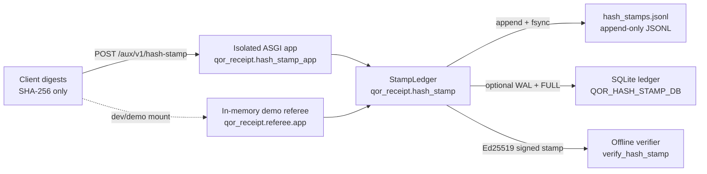

# Auxiliary Hash-Stamp Service (`qortime.aux.hash_stamp.v1`)

The auxiliary hash-stamp service records when a QorTime service observed a set of session SHA-256 digests (`hand_timeline_head`, `hand_timeline_sha256`, and optional `frame_chain_head`, `receipt_sha256`, and `chunks`). It is a **fair-proof** timestamping layer built in PRs [#142](https://github.com/ConWan30/qortime/pull/142), [#146](https://github.com/ConWan30/qortime/pull/146), and [#147](https://github.com/ConWan30/qortime/pull/147).

## Boundaries

- **Digests only.** Zero video bytes, raw binaries, PII, or local paths cross this boundary.
- **Not a referee match ruling.** An auxiliary hash stamp never awards gold (`#e4c56d`), does not change `qor-receipt/v0` verification status, and does not establish capture validity or controller operator identity.
- **Fail-closed.** Unknown fields, non-standard JSON constants (`NaN`/`Infinity`), floats, invalid hex lengths, oversized bodies, missing/invalid signing keys, and broken ledger chains are rejected.

## Architecture



## Wire Contract

### Request (`qortime.aux.hash_stamp_request.v1`)

`POST /aux/v1/hash-stamp` accepts a UTF-8 JSON object (`MAX_BODY_BYTES = 16384`, 16 KiB) with exact top-level keys:

| Field | Required | Format |
| --- | --- | --- |
| `schema` | Yes | `"qortime.aux.hash_stamp_request.v1"` |
| `client_nonce` | Yes | 64-char lowercase hex |
| `digests` | Yes | Object with allowed keys below |

Allowed `digests` keys (unknown keys fail with HTTP `400`):

| Key | Required | Format |
| --- | --- | --- |
| `hand_timeline_head` | Yes | 64-char lowercase hex |
| `hand_timeline_sha256` | Yes | 64-char lowercase hex |
| `frame_chain_head` | No | 64-char lowercase hex |
| `receipt_sha256` | No | 64-char lowercase hex |
| `chunks` | No | Integer in `0..10_000_000` (`MAX_CHUNKS`) |

**Idempotency:** re-sending the same `client_nonce` with identical canonical digests returns the original stamp. Re-using a `client_nonce` with different digests fails closed with HTTP `409` (`nonce_conflict`).

### Stamp Response (`qortime.aux.hash_stamp.v1`)

Returned by `POST /aux/v1/hash-stamp` and `GET /aux/v1/hash-stamp/{stamp_id}`:

- Top-level keys: `schema`, `stamp_id`, `public_key` (64-char hex), `sig` (128-char Ed25519 hex), `unsigned_payload`.
- `unsigned_payload` keys: `alg` (`"Ed25519"`), `claims`, `client_nonce`, `digests`, `issued_wall_ms`, `key_id` (16-char hex), `ledger_seq` (contiguous integer from `0`), `prev_ledger_sha256` (64-char hex, starting from `GENESIS = "0" * 64`), `schema`, `service` (`"qortime-aux-hash-stamp"`).
- **Canonicalization & framing:** `unsigned_payload` is canonicalized with RFC 8785 JCS (`qor_receipt.jcs.canonicalize`) and length-prefixed as `u64_be(len(label)) || label || u64_be(len(data)) || data` using three domain labels:
  - `QORTIME-AUX-STAMP-ID-v1` — hashes canonical `unsigned_payload` to derive `stamp_id`
  - `QORTIME-AUX-HASH-STAMP-v1` — Ed25519 signature domain over canonical `unsigned_payload`
  - `QORTIME-AUX-STAMP-LEDGER-v1` — hashes `{ledger_seq, prev, stamp_id}` to derive `entry_ledger_sha256` for the next entry's `prev_ledger_sha256`

## Persistent Append-Only Ledger (`StampLedger`)

Implemented in `qor_receipt/hash_stamp.py` (PR #146):

- **Storage backends:** `StampLedger` runs in-memory by default, or persists to SQLite (`QOR_HASH_STAMP_DB` / `stamp_db_path`), append-only canonical JSONL (`QOR_HASH_STAMP_JSONL` / `stamp_jsonl_path`), or both.
- **Durability:** SQLite uses `PRAGMA journal_mode=WAL`, `PRAGMA synchronous=FULL`, and atomic `BEGIN IMMEDIATE` / `COMMIT` transactions. JSONL appends one JCS-canonical line per entry followed by `flush()` + `os.fsync()`.
- **Startup replay & chain check:** On startup (and on demand via `StampLedger.verify_chain()`), the ledger replays every entry from `ledger_seq = 0` and `GENESIS`, re-checks `verify_hash_stamp()` signatures and IDs, recomputes `entry_ledger_sha256`, and enforces exact SQLite-vs-JSONL parity when both are configured. Any gap, corrupt line, bad signature, or mirror divergence raises `HashStampError(500, "ledger_corrupted")`.
- **Capacity:** Default `max_entries = 100_000`; when reached, `POST` returns HTTP `503` (`ledger_full`).

## Isolated Cloud Run Service (`qor_receipt.hash_stamp_app`)

Implemented in `qor_receipt/hash_stamp_app.py` and `services/hash-stamp/` (PR #147).

### Exposed Routes

| Method & Path | Behavior |
| --- | --- |
| `GET /healthz` | `O(1)` probe reading startup flags only (no disk read, no `verify_chain`, no lock). Returns `200` with `key_id` when ready, or `503` if startup chain verification failed. |
| `GET /aux/v1/hash-stamp/key` | Returns `{service, alg, key_id, public_key, claims}` (or `503` if not ready). |
| `POST /aux/v1/hash-stamp` | Enforces `MAX_BODY_BYTES = 16 KiB` via both `Content-Length` and streaming chunk count (HTTP `413` on oversize), then issues or returns the idempotent stamp. |
| `GET /aux/v1/hash-stamp/{stamp_id}` | Looks up a previously issued stamp by 64-char hex `stamp_id` (`404` if unknown). |

`/matches/*`, `/referee`, `/docs`, `/redoc`, and `/openapi.json` are disabled on this ASGI app.

### Fail-Closed Key Loading

`load_signing_key_from_env()` requires a 64-character hex Ed25519 seed and never generates an ephemeral key or logs secret material:

1. `QOR_HASH_STAMP_SEED_FILE` (recommended Secret Manager volume mount path, e.g. `/run/secrets/hash-stamp-seed/seed`)
2. `QOR_HASH_STAMP_SEED` (environment variable fallback)

### Cloud Run Deploy Templates (`services/hash-stamp/`)

- `Dockerfile`: `python:3.12-slim`, non-root user `10001:10001`, installs minimal `.[referee]` extra, starts `uvicorn qor_receipt.hash_stamp_app:app --workers 1 --limit-concurrency 32 --timeout-keep-alive 30` with `QOR_HASH_STAMP_AUTOSTART=1` and `QOR_HASH_STAMP_JSONL=/data/hash_stamps.jsonl`.
- `cloudbuild.yaml`: Artifact Registry build template targeting `us-central1` (`_REGION`, `_AR_REPO`, `_TAG`).
- `service.yaml`: Cloud Run `gen2` declarative template:
  - `minScale: "0"`, `maxScale: "1"` (single-writer serialization for `/data/hash_stamps.jsonl` over Cloud Storage FUSE `gcsfuse.run.googleapis.com`).
  - `cpu: "1"`, `memory: 512Mi`, `containerConcurrency: 16`, `timeoutSeconds: 30`.
  - Secret Manager read-only mount (`qortime-hash-stamp-seed` -> `/run/secrets/hash-stamp-seed/seed`).
  - **IAM-required beta access:** deployed with `--no-allow-unauthenticated`; never grant `roles/run.invoker` to `allUsers`.
  - Probes: `startupProbe` on `/healthz` (`initialDelaySeconds: 2`, `periodSeconds: 10`, `failureThreshold: 6` — sized for single startup `verify_chain` at `~2.3 s CPU @ 10k stamps` ESTIMATED plus GCS FUSE read margin) and `livenessProbe` on `/healthz` (`periodSeconds: 30`, `O(1)` flag check).

## Offline Verification

`verify_hash_stamp(stamp, *, trusted_pubkeys=None, trusted_key_ids=None, expected_digests=None)` in `qor_receipt/hash_stamp.py` checks a stamp offline with no network calls:

- Exact top-level and `unsigned_payload` keys, schema, `alg`, `service`, and `claims` text
- Hex formats, safe integer bounds for `issued_wall_ms` and `ledger_seq`, and `kid(public_key) == key_id`
- Recomputed `stamp_id` (`QORTIME-AUX-STAMP-ID-v1`) and Ed25519 signature (`QORTIME-AUX-HASH-STAMP-v1`)
- Optional `expected_digests` exact type-and-value match
- Optional `trusted_pubkeys` / `trusted_key_ids` membership (`key_trusted: True | False | None`)

## Running Locally

```bash
# Isolated hash-stamp service (fail-closed; requires a 64-hex seed)
QOR_HASH_STAMP_AUTOSTART=1 \
QOR_HASH_STAMP_SEED=<64-char-hex-seed> \
QOR_HASH_STAMP_JSONL=/tmp/hash_stamps.jsonl \
uvicorn qor_receipt.hash_stamp_app:app --port 8080 --workers 1
```

The in-memory dev referee (`qor_receipt.referee.app:app`) also mounts the `/aux/v1/hash-stamp*` endpoints and honors `QOR_HASH_STAMP_DB` / `QOR_HASH_STAMP_JSONL`.
